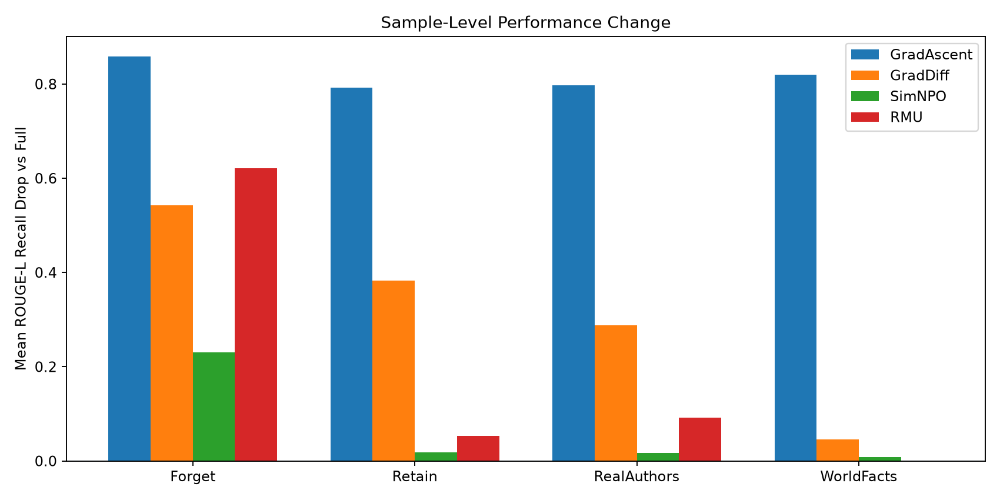
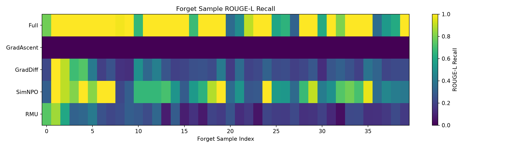
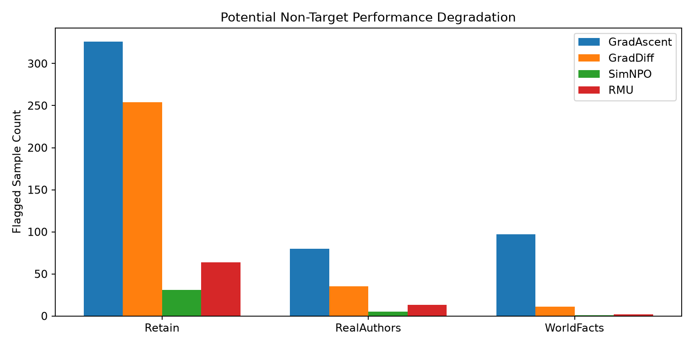

# Analysis01：TOFU 四算法逐样本遗忘与知识损伤分析

## 一、分析信息

- 时间：2026-10-10T23:09:03
- 原始模型：经过 SHA-256 验证的 Full
- 遗忘算法：GradAscent、GradDiff、SimNPO、RMU
- 数据来源：五个模型的真实 TOFU_EVAL.json
- 分析方式：固定样本索引的成对比较
- 是否重新训练：否
- 是否重新评估：否

## 二、样本一致性

五个模型的四个数据集均通过索引、问题文本、
标准答案和逐样本指标检查。

数据集：Forget 40、Retain 400、
RealAuthors 100、WorldFacts 117。

## 三、指标定义

ROUGE 下降：

`ROUGE_Full - ROUGE_Unlearned`

答案概率下降：

`Prob_Full - Prob_Unlearned`

正值代表相对于 Full 降低，负值代表提高。

Forget 中的下降表示目标答案匹配度或概率偏好降低，
但不能单独证明成功遗忘。

非目标数据中的下降表示潜在性能损伤，
不等价于知识已被永久删除。

探索性标记规则：

- Full ROUGE-L Recall >= 0.5
- 相对 Full 的 ROUGE-L Recall 下降 >= 0.2

该阈值不是 TOFU 官方损伤判定阈值，
仅用于筛选需要人工复核的样本。

## 四、四算法分析结果

| 数据集 | 算法 | 样本数 | 平均 ROUGE 下降 | 平均概率下降 | 标记样本数 |
|---|---|---:|---:|---:|---:|
| Forget | GradAscent | 40 | 0.85821 | 0.90186 | 36 |
| Forget | GradDiff | 40 | 0.54202 | 0.89331 | 33 |
| Forget | SimNPO | 40 | 0.23076 | 0.13965 | 16 |
| Forget | RMU | 40 | 0.62122 | 0.86995 | 34 |
| Retain | GradAscent | 400 | 0.79215 | 0.87101 | 326 |
| Retain | GradDiff | 400 | 0.38307 | 0.46096 | 254 |
| Retain | SimNPO | 400 | 0.01851 | -0.00150 | 31 |
| Retain | RMU | 400 | 0.05345 | 0.04143 | 64 |
| RealAuthors | GradAscent | 100 | 0.79700 | 0.01609 | 80 |
| RealAuthors | GradDiff | 100 | 0.28833 | 0.01266 | 35 |
| RealAuthors | SimNPO | 100 | 0.01750 | 0.00270 | 5 |
| RealAuthors | RMU | 100 | 0.09250 | -0.00125 | 13 |
| WorldFacts | GradAscent | 117 | 0.81937 | 0.00537 | 97 |
| WorldFacts | GradDiff | 117 | 0.04630 | 0.00427 | 11 |
| WorldFacts | SimNPO | 117 | 0.00855 | 0.00102 | 1 |
| WorldFacts | RMU | 117 | 0.00000 | -0.00060 | 2 |

## 五、结果图表

## 六、分析注意事项

1. 当前是单次训练的描述性分析，不构成显著性排名。
2. GradAscent 的 Model Utility 为零，应特别防止
   将整体能力崩溃误判为选择性遗忘。
3. ROUGE 较低可能来自拒答、乱码、内容偏移或答案错误。
4. 逐样本 CSV 保留了原始问题、标准答案和生成内容，
   可用于后续人工知识损伤分类。
5. 不同数据集的样本数不同，不应只根据标记总数
   比较跨数据集的损伤程度。
6. 本阶段尚未运行提示恢复、语义改写、
   多轮诱导或重新学习攻击。

## 七、文件说明

- `tables/*_all_models.csv`：全部模型逐样本明细
- `tables/*_top_damage.csv`：非目标潜在损伤前30名
- `tables/Forget_*_top_residual.csv`：目标知识残留前30名
- `tables/analysis_summary.csv`：汇总分析结果
- `figures/`：实验图表
- `SOURCE_MANIFEST.json`：原始文件路径及 SHA-256

原始 Clean 实验与 Exp009 均保持不变。
