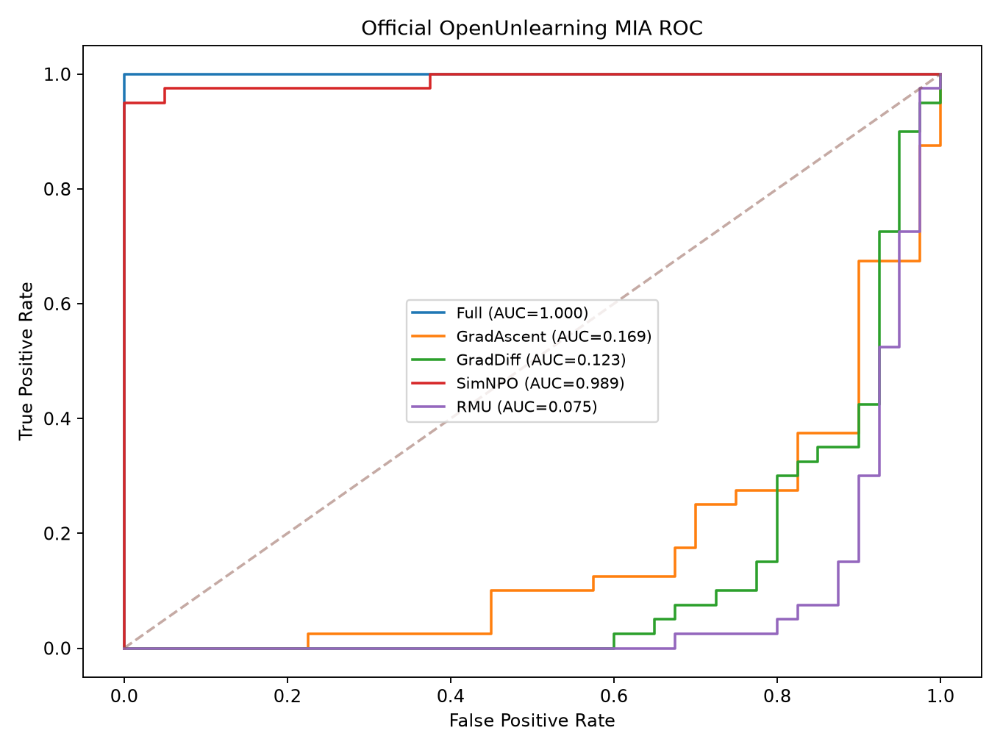
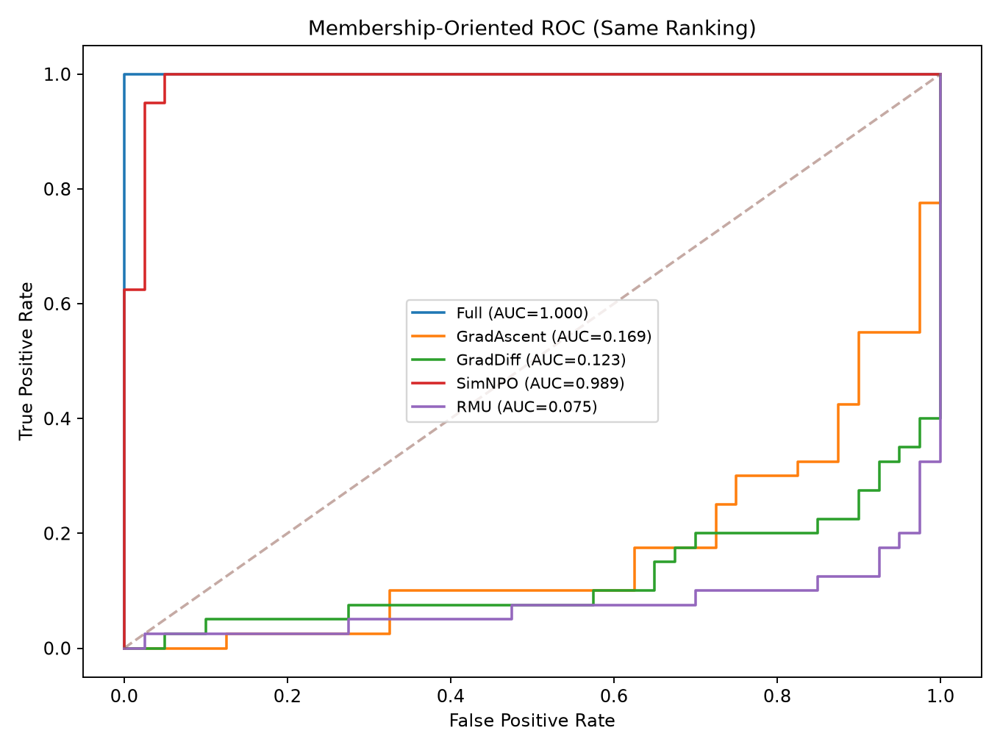
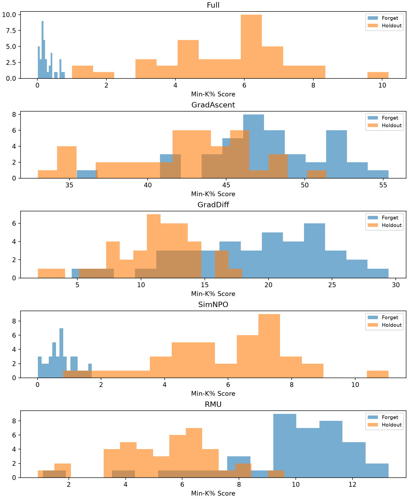
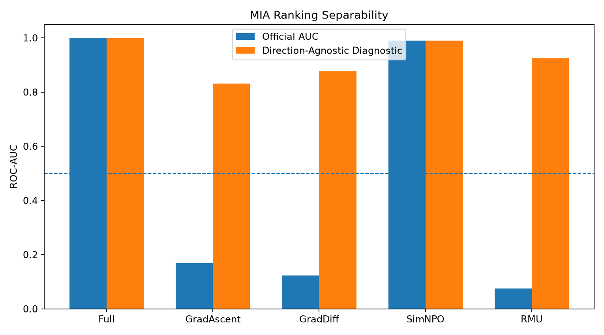

# Analysis02：MIA 成员推断与隐私风险分析

## 一、分析基本信息

- 创建时间：2026-10-10T23:37:41
- 数据来源：五个模型已保存的 TOFU_EVAL.json
- Forget：40 样本
- Holdout：40 样本
- 攻击方法：OpenUnlearning Min-K% Probability Attack
- 是否使用 GPU：否
- 是否执行新的攻击：否，仅分析已有攻击分数
- Bootstrap：分层重采样 2000 次
- 随机种子：20261010

## 二、来源与指标定义

依据本地 OpenUnlearning 源代码：

- `src/evals/metrics/mia/min_k.py`
- `src/evals/metrics/mia/utils.py`
- `src/evals/metrics/privacy.py`

官方将 Forget 标记为 0，Holdout 标记为 1；
使用负的最低 K% Token 对数概率均值作为 Min-K% 分数。

- 官方 AUC：`roc_auc_score(labels, scores)`
- 反向 AUC：`1 - official_auc`
- 方向无关诊断：`max(AUC, 1-AUC)`

方向无关 AUC 是本研究补充的探索性指标，
**不是 OpenUnlearning 官方隐私泄露指标，
也不是经过独立校准的现实攻击成功率。**

## 三、结果

| 模型 | 官方 AUC | 95% CI | 方向无关 AUC | 95% CI |
|---|---:|---:|---:|---:|
| Full | 1.0000 | [1.0000, 1.0000] | 1.0000 | [1.0000, 1.0000] |
| GradAscent | 0.1688 | [0.0844, 0.2719] | 0.8313 | [0.7281, 0.9156] |
| GradDiff | 0.1231 | [0.0506, 0.2138] | 0.8769 | [0.7862, 0.9494] |
| SimNPO | 0.9894 | [0.9650, 1.0000] | 0.9894 | [0.9650, 1.0000] |
| RMU | 0.0750 | [0.0162, 0.1481] | 0.9250 | [0.8519, 0.9838] |

## 四、图表

## 五、低误报率与隐私解释

低误报率 TPR 采用经验 ROC 上 FPR<=5% 的最大 TPR，
不进行插值。详细数值见 `tables/MIA_summary.csv`。

只有 40 个 Holdout 样本，FPR 步长为 2.5%，
因此不把低 FPR 的 TPR 作为医学隐私保证。

Min-K 分数中的 AUC 低于 0.5 表示发生反向排序，
并不等于攻击者无法区分 Forget 和 Holdout。

对同一批样本事后选择最佳方向会产生评估偏差，
方向无关 AUC 仅作为数据分离的描述性诊断。
后续真实攻击应使用独立校准集确定方向，
再在不重叠的测试集进行验证。

PrivLeak 按 OpenUnlearning 定义为相对参考值变化，
不等于隐私泄露百分比。

## 六、研究局限性

1. TOFU 为虚构人物数据，不构成真实患者隐私实验。
2. 分层 Bootstrap 置信区间反映此样本规模下的抽样不确定性，
   不涵盖不同随机种子、攻击模型或数据分布的变化。
3. 当前 MIA 是一种固定 Min-K% 分数攻击，
   未涵盖更强的自适应成员推断攻击。
4. GradAscent 存在 Model Utility 为零的问题，
   不能单凭 MIA 分数解释为有效隐私保护。
5. 本分析未测试敏感属性推断、患者记录重建或遗忘恢复攻击。

## 七、文件与可复现性

- `tables/MIA_summary.csv`：五模型统计指标
- `tables/MIA_sample_scores.csv`：原始逐样本 Min-K 分数
- `figures/`：四张真实数据绘图
- `scripts/analyze_mia.py`：本次实际分析代码
- `SOURCE_MANIFEST.json`：原始评估文件哈希

原始 Clean 模型、评估文件和封存的 Exp009 保持不变。
