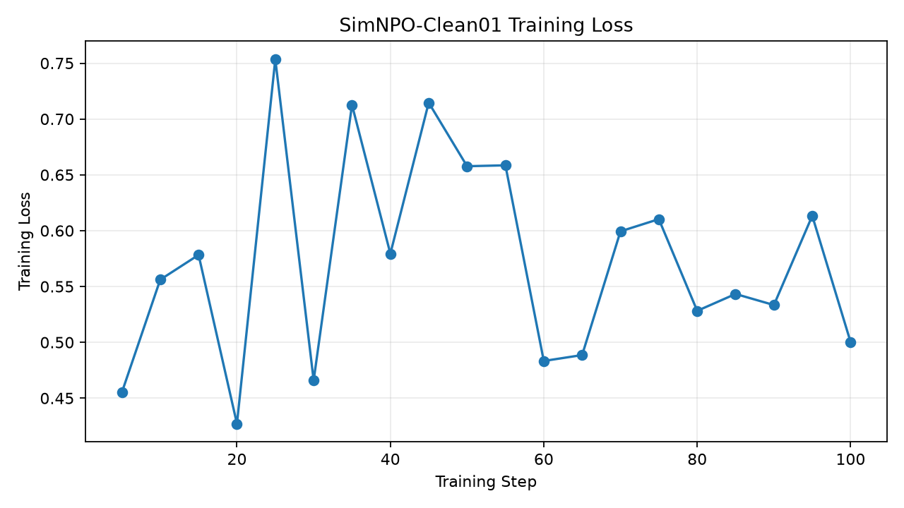
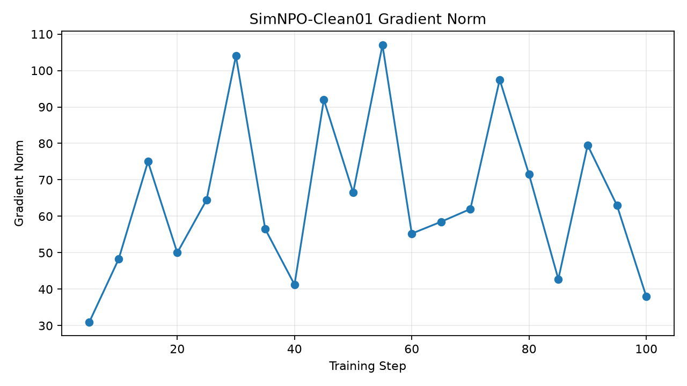

# 实验三：SimNPO-Clean01 中文实验报告

## 一、实验信息

- 实验算法：SimNPO
- 初始模型：SHA-256 已验证的 TOFU Full
- Forget 数据：forget01
- Retain 数据：retain99
- Holdout 数据：holdout01
- 训练步数：100
- 训练轮数：10.0
- 归档时间：2026-10-10 22:53:23

## 二、实验目的

修正历史实验中疑似异常的初始模型权重，
验证 SimNPO 在目标知识遗忘和非目标能力保留方面的表现。

## 三、训练参数

- Epochs：10
- 学习率：1e-5
- Batch Size：1
- 梯度累积：4
- BF16：开启
- Gradient Checkpointing：开启
- 优化器：paged_adamw_32bit
- gamma：0.125
- alpha：1.0
- beta：4.5
- delta：0.0
- retain_loss_type：NLL

完整训练配置见 `train_config.yaml`。

## 四、评估协议

使用统一 TOFU 评估：

- Forget：forget01
- Holdout：holdout01
- Retain99：参考模型评估日志
- Batch Size：1
- BF16 + SDPA

## 五、实验指标

| 指标 | 数值 |
|---|---:|
| extraction_strength | 0.374963437 |
| forget_Q_A_Prob | 0.7622070312 |
| forget_Q_A_ROUGE | 0.6274528959 |
| forget_quality | 0.006760732304 |
| forget_truth_ratio | 0.4713377074 |
| model_utility | 0.5969923226 |
| privleak | -97.97859689 |

## 六、五模型对比

| 指标 | Full | GradAscent | GradDiff | SimNPO | RMU |
|---|---:|---:|---:|---:|---:|
| model_utility | 0.599023 | 0 | 0.471516 | 0.596992 | 0.586851 |
| forget_Q_A_ROUGE | 0.858212 | 0 | 0.316188 | 0.627453 | 0.236988 |
| forget_Q_A_Prob | 0.901855 | 4.35575e-11 | 0.00854999 | 0.762207 | 0.031909 |
| forget_quality | 0.00676073 | 1.48827e-21 | 0.404587 | 0.00676073 | 0.164973 |
| extraction_strength | 0.723969 | 0.0290594 | 0.0483443 | 0.374963 | 0.0290594 |

## 七、实验结论

SimNPO 的 Forget ROUGE 为 0.627453，
Forget QA Probability 为 0.762207，
表明模型仍能较大程度地保留目标数据答案。

Model Utility 为 0.596992，
相对 Full 下降约 0.34%，整体非目标效用保留较好。

Forget Quality = 0.00676073
是 KS 检验的 p 值，不是遗忘成功率。

与 RMU-Clean01 和 GradDiff-Clean01 相比，
SimNPO 在本次超参数设置下表现出更明显的
“能力保留较好，但遗忘不足”的现象。

当前结果不能证明模型具备抵抗提示恢复和重新学习攻击的能力。

## 八、实验图片

## 九、原始数据与复现说明

训练目录：`/home/research/open-unlearning/saves/unlearn/tofu_Llama-3.2-1B-Instruct_forget01_SimNPO_Clean01`

评估目录：`/home/research/open-unlearning/saves/eval/tofu_Llama-3.2-1B-Instruct_forget01_SimNPO_Clean01_eval`

详细逐样本评估保留在原始 TOFU_EVAL.json，
本归档包含配置、训练状态及官方汇总指标副本。

本实验归档不修改训练权重、历史实验和 Exp009。
