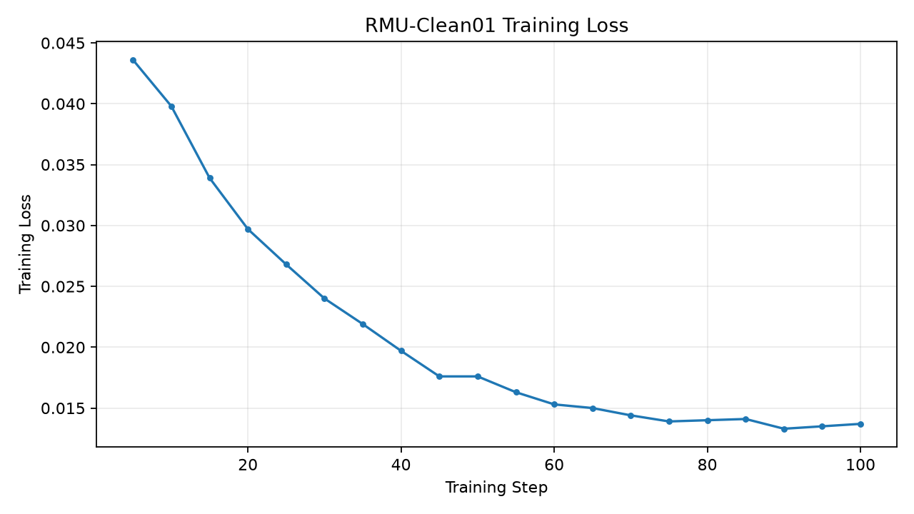
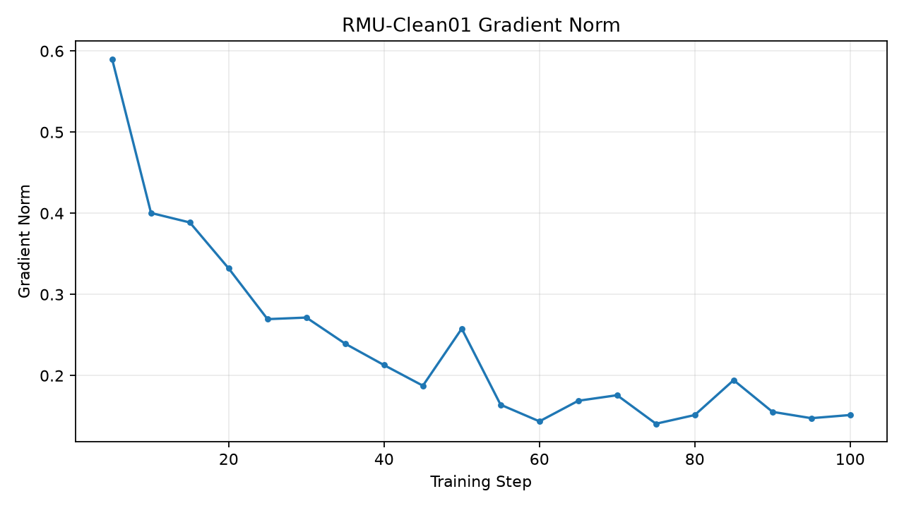
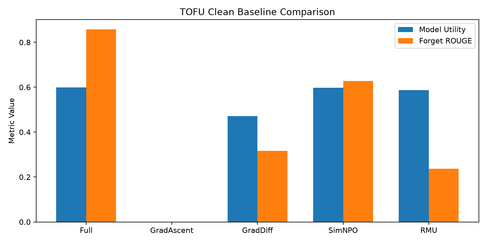

# 实验四：RMU-Clean01 中文实验报告

## 一、实验基本信息

- 遗忘算法：RMU（Representation Misdirection for Unlearning）
- 数据集：TOFU
- 遗忘数据：forget01
- 保留数据：retain99
- 评估 Holdout：holdout01
- 初始模型：已完成 SHA-256 校验的官方 TOFU Full
- 训练步数：100
- 训练轮数：10.0
- 归档时间：2026-10-10 22:58:54

## 二、实验目的

使用经过完整性验证的初始模型，复现实验四 RMU，
分析目标知识遗忘效果与非目标能力保留之间的权衡。

## 三、实际训练配置

实际配置文件已保存为 `train_config.yaml`。

训练过程中记录了 20 条 Loss，
以及 20 条梯度范数数据。

本报告不把不同算法的训练 Loss 直接作为优劣指标。

## 四、统一评估协议

- Forget：forget01
- Holdout：holdout01
- Retain99：参考评估日志
- Batch Size：1
- BF16 + SDPA

实际评估配置见 `eval_config.yaml`。

## 五、RMU 官方汇总指标

| 指标 | 数值 |
|---|---:|
| extraction_strength | 0.02905940823 |
| forget_Q_A_Prob | 0.03190903664 |
| forget_Q_A_ROUGE | 0.2369881977 |
| forget_quality | 0.1649726995 |
| forget_truth_ratio | 0.7761133338 |
| model_utility | 0.5868513008 |
| privleak | 75.98097502 |

## 六、五模型对比

| 指标 | Full | GradAscent | GradDiff | SimNPO | RMU |
|---|---:|---:|---:|---:|---:|
| forget_Q_A_ROUGE | 0.858212 | 0 | 0.316188 | 0.627453 | 0.236988 |
| forget_Q_A_Prob | 0.901855 | 4.35575e-11 | 0.00854999 | 0.762207 | 0.031909 |
| model_utility | 0.599023 | 0 | 0.471516 | 0.596992 | 0.586851 |
| forget_quality | 0.00676073 | 1.48827e-21 | 0.404587 | 0.00676073 | 0.164973 |
| extraction_strength | 0.723969 | 0.0290594 | 0.0483443 | 0.374963 | 0.0290594 |

## 七、实验结果分析

1. RMU 的 Forget ROUGE 为
   0.236988，
   相比原始 Full 下降约 72.39%。
2. Forget QA Probability 为
   0.031909，
   说明目标答案概率偏好显著下降。
3. Model Utility 为
   0.586851，
   相对 Full 下降约 2.03%。
4. Forget Quality 为
   0.164973，
   是 KS 检验 p 值，不是遗忘成功率。
5. Extraction Strength 为
   0.029059，
   反映指定前缀续写评估下目标答案的可提取性。
6. Privleak 为
   75.980975，
   不能直接解释为隐私泄露百分比。
7. 当前结果表明，RMU 在降低目标答案匹配度的同时，
   较好地保持了综合模型效用。
8. 仍需要逐样本检查 Retain、Real Authors、
   World Facts 的知识损伤，并开展提示恢复与重新学习攻击。

## 八、实验图表

## 九、源代码及可追溯性说明

训练目录：
`/home/research/open-unlearning/saves/unlearn/tofu_Llama-3.2-1B-Instruct_forget01_RMU_Clean01`

评估目录：
`/home/research/open-unlearning/saves/eval/tofu_Llama-3.2-1B-Instruct_forget01_RMU_Clean01_eval`

详细评估结果位于原始 `TOFU_EVAL.json`。

源代码快照来源：
`/home/research/open-unlearning/reports/Experiment02_GradDiff_Clean01/code`

记录的 Git Commit：
`4ad738aaf60f6a4385f6e2506d01da99e76c31f3`

Git Dirty：
`True`

**注意：源代码快照复制自归档时的项目代码，
不保证与 RMU 训练当时的未提交修改完全一致。**

本归档不复制大型模型权重，也不修改历史实验或 Exp009。
