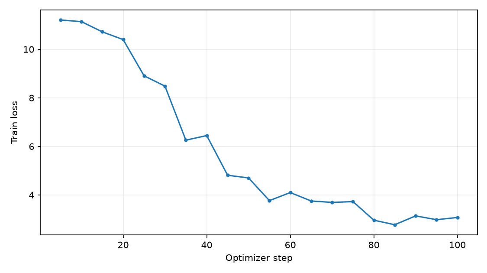
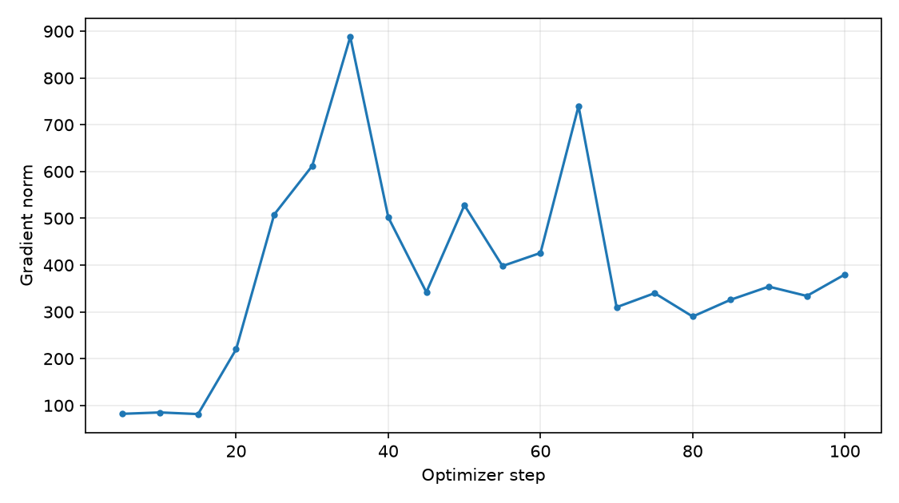
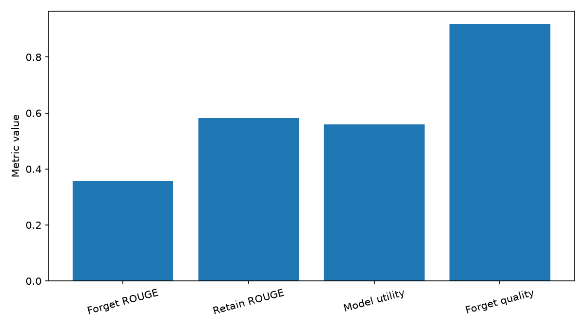

# SimNPO_Repair_B05_G1_Seed1 实验报告

## 一、实验基本信息

- 实验名称：`tofu_Llama-3.2-1B-Instruct_forget01_SimNPO_Repair_B05_G1_Seed1`
- 训练状态：完成，global_step=100，epoch=10.0
- 评测状态：完成
- 归档日期：2026-10-15T10:40:42
- 数据集：TOFU；Forget=forget01，Retain=retain99，Holdout=holdout01（按实验命名与评测设置复核）

## 二、训练配置

- 初始模型：`/home/research/hf-cache-clean/hub/models--open-unlearning--tofu_Llama-3.2-1B-Instruct_full/snapshots/88e31200b97e4c0c04ae0d2f0b591f427046d192`
- Learning Rate：1e-05
- Epochs (config)：10
- Max Steps (config)：100
- Optimizer：paged_adamw_32bit
- Per-device batch：1
- Gradient accumulation：4
- Seed：1
- BF16：True
- Method args：`{"gamma": 1.0, "alpha": 1.0, "retain_loss_type": "NLL", "delta": 0.0, "beta": 0.5}`

## 三、TOFU 真实评估指标

| 指标 | 数值 |
|---|---:|
| forget_quality | 0.9188052214 |
| model_utility | 0.5593911389 |
| forget_truth_ratio | 0.5726965152 |
| forget_Q_A_Prob | 0.02398796082 |
| forget_Q_A_ROUGE | 0.3555603432 |
| retain_Q_A_Prob | 0.7735180664 |
| retain_Q_A_ROUGE | 0.5818656437 |
| ra_Q_A_ROUGE | 0.6995 |
| wf_Q_A_ROUGE | 0.8279202279 |
| extraction_strength | 0.07579531613 |
| privleak | 60.40428061 |

## 四、结果解读与限制

- Forget Quality 是 KS 检验的 p 值，不代表遗忘成功比例。
- 此归档仅陈列真实日志和指标，不据单个指标宣称遗忘成功。
- 与官方不同训练批量/预算的结果不可直接视为严格同协议比较。
- 训练配置与评测结果应结合模型原始检查点核对；本归档不复制大型权重。

## 五、实验图片

## 六、原始数据与完整性

- 原始训练目录：`/home/research/open-unlearning/saves/unlearn/tofu_Llama-3.2-1B-Instruct_forget01_SimNPO_Repair_B05_G1_Seed1`
- 原始评测目录：`/home/research/open-unlearning/saves/eval/tofu_Llama-3.2-1B-Instruct_forget01_SimNPO_Repair_B05_G1_Seed1_eval`
- `MANIFEST.sha256` 保存原始数据和本归档文件的校验摘要。
- `TOFU_EVAL.json` 仅用于提取聚合值并计算 SHA256，不复制大体积逐样本评测。
